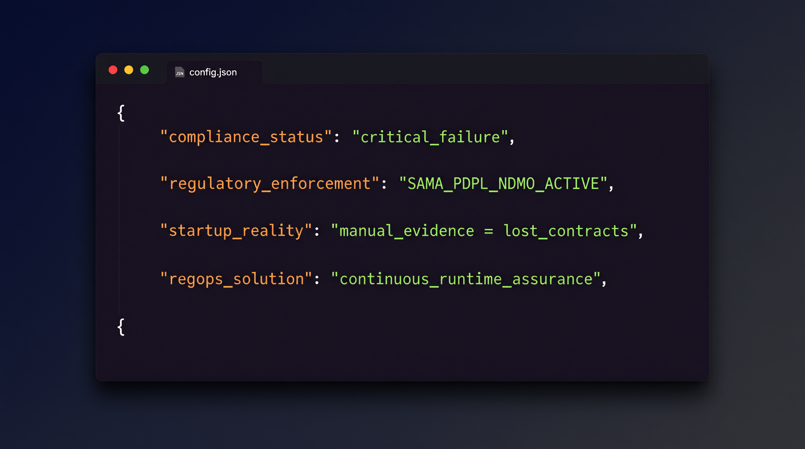
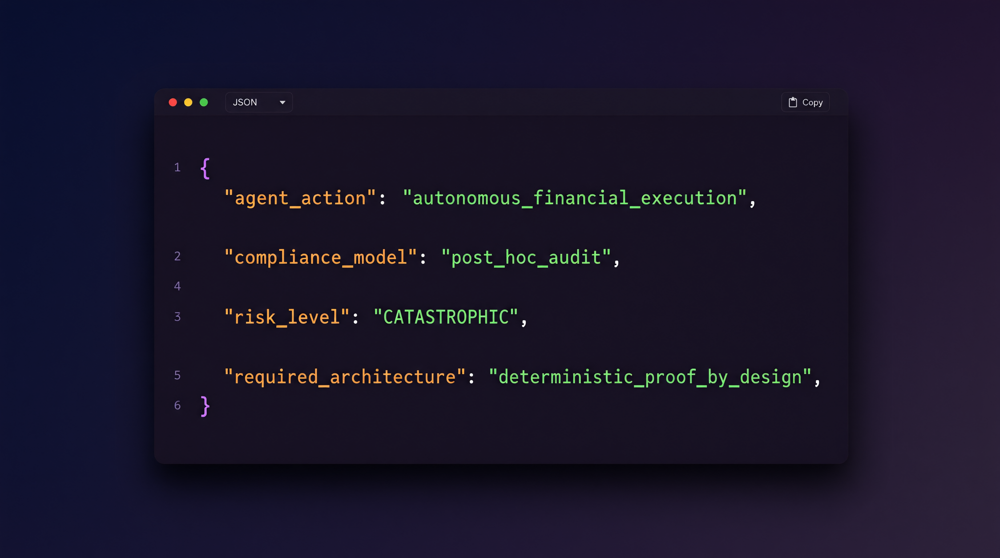
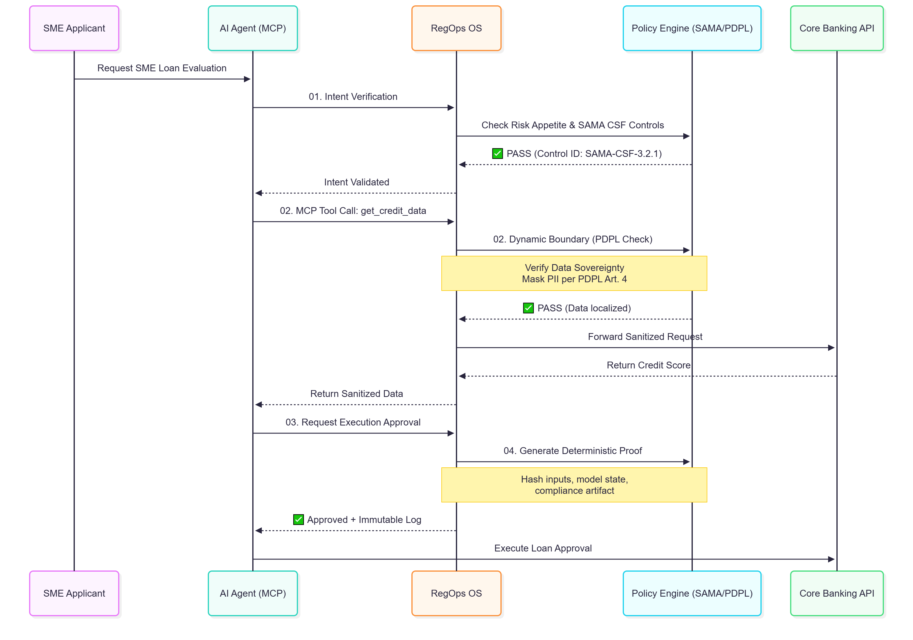
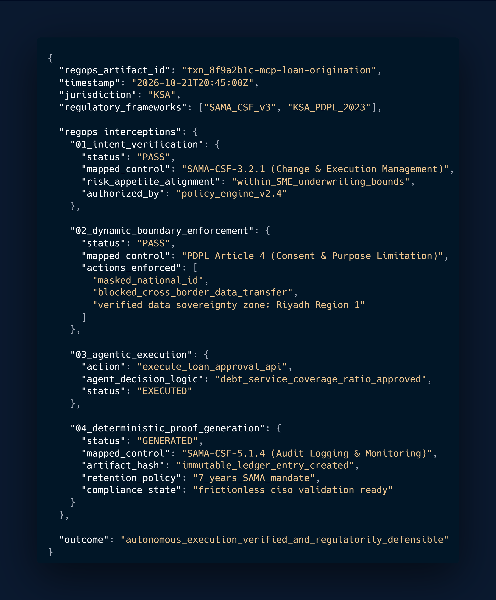

# The Agentic Governance Matrix
### The Open-Source Standard for AI Production Readiness Architecture
*Version 1.0 | Maintained by ComplyFlow AI (RegOps OS)*

---

## 📜 The Manifesto: The MCP Blindspot
Autonomous agents (via Model Context Protocol - MCP) execute financial and operational workflows at machine speed. Yet, traditional compliance audits operate at human speed. This creates the **Demo-to-Production Gap**. 

Treating compliance as a post-hoc, static document is a fatal flaw. When agents operate autonomously, a retrospective audit is a liability, not a safeguard. Governance must evolve from an administrative framework into an **architectural guarantee**. We must shift from documented claims to deterministic, runtime proof.

---

## 🏛️ The RegOps Architecture: 3 Pillars
This matrix defines the standard for embedding governance directly into the AI execution loop, forming the core of **AI Production Readiness Architecture**.

### 01. Intent Verification (The "Why")
Validating the strategic purpose behind an agent's action *before* execution.
* **Standard:** Every autonomous action must be preceded by a cryptographic intent hash aligned with organizational risk appetite.
* **Outcome:** Prevents rogue automation and scope creep.

### 02. Dynamic Boundary Enforcement (The "Where")
Continuous runtime assurance ensuring agent actions remain within strict regulatory perimeters.
* **Standard:** Real-time interception of MCP tool calls to validate against data sovereignty (e.g., PDPL) and financial limits (e.g., SAMA CSF).
* **Outcome:** Protects data without stifling engineering velocity.

### 03. Deterministic Proof (The "Proof")
Translating autonomous actions into a continuous stream of regulatory-grade trust artifacts.
* **Standard:** Generation of an immutable, vendor-neutral JSON artifact post-execution, containing timestamp, agent ID, boundary check result, and cryptographic hash.
* **Outcome:** Compresses 3-week enterprise security reviews into 3-hour automated validations.

---

## ️ The Regulatory Mapping (GCC Focus)
Generic AI frameworks fail in the GCC because they ignore local mandates. This matrix maps directly to:
* **SAMA CSF:** Controls for AI/ML in financial services and third-party risk.
* **PDPL (KSA) / UAE Data Law:** Data sovereignty, minimization, and cross-border transfer restrictions in agent workflows.
* **NDMO:** Data classification and handling protocols.
* **Global Alignment:** ISO 42001 (AIMS), ISO 27090 (Cybersecurity for AI), and IEEE agentic security frameworks.

---

## 🚀 Escaping "Procurement Purgatory"
Enterprise buyers no longer accept "black box" demos. They demand continuous, deterministic proof. 
* **Legacy Approach:** Manual screenshot hunting, point-in-time PDF audits, high "audit fatigue."
* **Modern Standard (This Matrix):** Automated, immutable evidence plumbing, real-time audit trails, zero friction for CI/CD.

*By embedding Continuous Deterministic Assurance into MVPs from Day 1, startups turn compliance from a bottleneck into a sales accelerator.*

---

## ⚖️ Specification vs. Implementation (The Open-Core Model)
* **This Repository (Open Specification):** Contains the architectural patterns, JSON schemas, regulatory mappings, and threat models. It is free to use, modify, and distribute under the MIT License.
* **ComplyFlow AI RegOps OS (Proprietary Implementation):** The managed, enterprise-grade engine that automatically executes this matrix, providing the interceptor, the automated SAMA/PDPL mapping, and the managed compliance dashboard. 

*We give away the blueprint. We build the engine.*

---

## 🤝 Contribution & Adoption
We invite CISOs, AI architects, and regulatory experts to contribute to this living standard. 
* **To Adopt:** Use the JSON schemas in `/schemas` to structure your agent audit trails.
* **To Contribute:** Submit a Pull Request with new regulatory mappings or architectural patterns.

---

## 🖼️ Visual Documentation

### The Regulatory Landscape

### The RegOps Architecture

---

 ---
 ### ⚖️ Legal & Trademark Notice
Copyright © 2026 ComplyFlow AI. All rights reserved.
   
This repository is licensed under the MIT License. However, the "ComplyFlow AI" name, logo, and specific architectural documentation are proprietary trademarks of ComplyFlow AI. Use of the code does not grant permission to use the ComplyFlow AI brand, logo, or to represent this project as an official ComplyFlow AI product.

---

*Built for the GCC AI Ecosystem | Continuous Assurance. Deterministic Trust.*  
*Fazal Malik | Founder, ComplyFlow AI*
